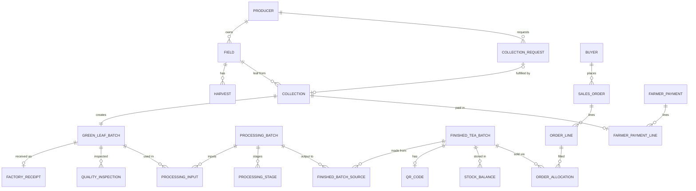

# Smart Tea – Database guide

**Source of truth: [`server/prisma/schema.prisma`](../server/prisma/schema.prisma)** (code-first).
The full schema for all 6 sprints is already in place (68 tables, 42 enums), built from the Jira backlog
US-001 … US-074 and the Role & Permission Matrix v2. Feature work should **use** these tables, not invent new ones.

| | |
|---|---|
| Database | PostgreSQL 17 on Neon (project in AWS Singapore) |
| ORM | Prisma 7.x with the `pg` driver adapter (stay on 7.x; npm `latest` is an 8.0 RC) |
| Migrations | `server/prisma/migrations/` – applied by `prisma migrate deploy` on every Render build |
| DB rules | `*_db_rules` and `*_full_schema_rules` migrations: 104 CHECK constraints + append-only / immutability triggers |

## 1. Golden rules (for people *and* coding agents)

1. **Change the schema only in `schema.prisma`**, then generate a migration (`npm run db:migrate -- --name <change>`).
   Commit the schema and the migration folder in the same PR as the code that uses them.
2. **Never** edit the database by hand (Neon SQL editor, psql, Prisma Studio for structure). The next deploy will fail or undo it.
3. **Never edit or delete a migration that is already on `main`.** Fix forward with a new migration.
4. **Never run `prisma migrate dev` or `prisma migrate reset` against the shared Neon branches** (`production`, `dev`).
   They can drop data. Use your own local database or your own Neon branch.
5. Only add columns as **optional or with a default** (tables already contain data).
6. CI checks that the migrations rebuild exactly the schema (`prisma migrate diff --exit-code`). A red CI here means the
   schema and migrations disagree – regenerate the migration, don't hand-edit around it.
7. When you add an enum value, also add it to `server/src/rules/enums.js` (a test checks they match).
8. When you add a table, add it to `TABLES` in `server/src/seed/seed.js`.
9. Keep migration `.sql` files **ASCII only**, comments included. On Windows the embedded test database uses WIN1252,
   and characters such as `─`, `→`, `≤` make `prisma migrate deploy` fail with P3018 / 22P05.

## 2. Conventions

| Topic | Rule |
|---|---|
| Names | Prisma models `PascalCase`, fields `camelCase`; tables/columns `snake_case` via `@map` / `@@map` |
| Ids | `String @id @default(uuid()) @db.Uuid`; human-readable codes are separate unique columns (`PRD-00001`, `GL-2026-11-0001`, `SO-00001` …) made by `services/counter.js` |
| Weights | `Decimal @db.Decimal(10|12, 3)` in **kg** (gram precision) |
| Money | `Decimal @db.Decimal(12|14, 2)`, `currency` defaults to `LKR` |
| Time | `DateTime @db.Timestamptz(3)`; calendar days (harvest date, payment period) use `@db.Date` |
| History | Records are **deactivated** (`isActive`, `status`), never deleted; relations use `onDelete: Restrict` |
| Approvals | `status` + `createdById` / `approvedById` (or `decidedById`) + `…At` + `rejectionReason` / `decisionReason` |
| Versioned rules | Grades, inspection parameters, tolerances, prices and payment rules are **versioned** (`@@unique([code, version])`). A change is a new row; old transactions keep pointing at the version they used |
| Copied values | A transaction copies the price it used (`collection.pricePerKg`, `orderLine.unitPrice`) so price changes never alter history |
| Append-only | `audit_log`, `stock_movement`, `batch_release_event`, `order_status_history`, `transport_job_event` refuse UPDATE/DELETE |
| Constraint names | `<table>_<column>_check` – the API error handler turns them into field errors (`middleware/errors.js`) |

## 3. Tables by module

### M1 Administration & security
| Table | Stories | Notes |
|---|---|---|
| `app_user` | US-001, 005, 006 | `roles Role[]` (multiple roles = union), `failedLogins`/`lockedUntil` (lockout), `mustChangePassword` |
| `permission`, `role_permission` | US-002, 008 | Matrix v2 as data; scope `ALL` / `OWN` / `ASSIGNED`. `rules/permissions.js` stays the code default and seeds it |
| `user_session` | US-001 | Hash of refresh token; logout = set `revokedAt` |
| `system_setting` | US-009, 012 | Key/JSON value, category `SECURITY` / `TECHNICAL` / `BUSINESS` |
| `audit_log` | US-003, 013 | Append-only; `category` separates business vs security/technical events |
| `system_log` | US-010, 012 | Technical errors; deleted after the retention period |
| `backup_run` | US-011 | Record of backups/restores (Neon does the actual backup) |

### Master data (US-007, US-027)
`unit`, `tea_grade`, `inspection_parameter` (allowed / standard / adjustment ranges + deduction %), `tolerance`
(`RECEIPT_WEIGHT`, `PROCESSING_VARIANCE`, `STOCK_COUNT`). All: `DRAFT → ACTIVE` after Management approval, from `effectiveFrom`.

### M2 Producers – M3 Collection
| Table | Stories | Notes |
|---|---|---|
| `collection_centre`, `producer_org`, `producer` | US-014, 015 | Producer `PENDING → VERIFIED / REJECTED` |
| `field` | US-016 | Area, variety, GPS |
| `harvest` | US-017 | `enteredById` shows farmer or officer-on-behalf |
| `collection_route`, `collection_request` | US-019 | `REQUESTED → SCHEDULED → COLLECTED / CANCELLED` |
| `collection` | US-020, 021 | Gross/tare/net (DB checks net = gross − tare), `receiptNo`, optional `requestId` |
| `green_leaf_batch` | US-022, 025 | 1:1 with collection; `batchCode` **cannot be changed** (trigger); `acceptedKg`, `availableKg` |
| `factory`, `factory_receipt` | US-023 | Received kg, discrepancy, `isFlagged` when outside tolerance |

### M4 + M6 Quality
`quality_inspection` (one table for `GREEN_LEAF` and `FINISHED_TEA`; leaf decision `ACCEPTED` / `ACCEPTED_WITH_ADJUSTMENT` / `REJECTED`),
`inspection_result` (value per parameter version), `rejected_batch_exception` (US-026).

### M5 Processing
`processing_batch` (US-028), `processing_input` (green leaf → processing, kg allocated), `processing_stage`
(US-029, DB checks output + by-product + loss ≤ input), `processing_reconciliation` (US-030, auto-accept or Management approval).

### M6 Finished tea – M7 Traceability
`finished_tea_batch` (US-031–034, `releaseStatus NOT_RELEASED / RELEASED / ON_HOLD`), `finished_batch_source`
(processing → finished), `batch_release_event` (history), `qr_code` (US-036, random token), `traceability_field_setting`
(US-038, what buyers/farmers see), `traceability_issue` (US-039, missing links).

### M8 Warehouse
`warehouse` → `warehouse_area` → `storage_location` (US-040); `stock_balance` (on hand + reserved per batch per location;
**DB refuses negative stock and reservations above on-hand**, so overselling is impossible – US-053); `stock_movement`
(every change, append-only); `stock_adjustment` (US-043, Management approval); `stock_count` + `stock_count_line` (US-044);
`low_stock_threshold` (US-046).

### M9 Buyers & orders – M10 Pricing
`buyer` (US-047), `product` + `product_batch` (US-048), `sales_order` (US-049–055), `order_line`, `order_allocation`
(which batch filled which order → forward traceability), `order_status_history`, `invoice` + `invoice_payment` (US-056),
`price_version` (US-057–059: `PURCHASE_GL` or `SELLING_FT` for a grade/product, `DRAFT → APPROVED / REJECTED`).

### M11 Farmer payments
`payment_adjustment_rule` (US-060), `farmer_payment` (US-061–064, `PREPARED → APPROVED / REJECTED → PAID`, one per
producer per period), `farmer_payment_line` (one per collection – a collection can't be paid twice), `farmer_payment_adjustment`.

### M12 Transport – M13 Notifications
`transporter`, `vehicle`, `driver` (US-065), `transport_job` (US-066, `COLLECTION` jobs carry collection requests,
`DELIVERY` jobs carry one order), `transport_job_event` (US-067/068 milestones), `proof_of_delivery`;
`notification` (US-069), `alert_rule` (US-070). M14 reports/dashboard/search are queries over these tables.

## 4. Traceability chain (US-035)



Backward: `finished_tea_batch → finished_batch_source → processing_batch → processing_input → green_leaf_batch → collection → producer / field`.
Forward: `green_leaf_batch → processing_input → finished_batch_source → finished_tea_batch → order_allocation → order_line → sales_order → buyer`.
Use a `WITH RECURSIVE` query or the joins above; all FK columns used here are indexed.

## 5. Rules: database vs app

The database enforces anything that can be checked on **one row** (CHECK) plus uniqueness, foreign keys and the triggers.
These need other rows, so the **app** checks them inside the same `prisma.$transaction`:

- only `VERIFIED` producers can be collected from (US-015); only `RELEASED` batches can be stocked in / listed / reserved (US-041, 048);
- `REJECTED` green-leaf batches can't be put into processing unless `rejected_batch_exception` exists (US-026, 028);
- allocated kg ≤ `available_kg` (US-028) – decrement it in the same transaction;
- order status transitions (US-050–055); price/payment approver ≠ creator (US-058, 062 – pending client);
- active version = newest `ACTIVE` row with `effectiveFrom <= now()`.

For stock, change `stock_balance` with a single `UPDATE … SET reserved_kg = reserved_kg + $1` inside the transaction and write the
matching `stock_movement` row; the CHECK constraint makes the second of two competing reservations fail (tested with two parallel sessions).

## 6. Environments and how the 4 of us connect

| Neon branch | Used by | How it changes |
|---|---|---|
| `production` | Render (live API) | Only by Render's build: `npx prisma migrate deploy` |
| `dev` (child of `production`) | All 4 team members' local servers | `npm run db:deploy` (= `prisma migrate deploy`) after pulling new migrations |
| `dev-<name>` (optional) | One person, to create migrations | `npm run db:migrate -- --name …`; delete/reset freely |

**One-time setup (team lead, in the Neon console):** Project → **Branches → New branch** `dev` from `production` →
**Connect** → copy the *pooled* and *direct* strings → share them privately (not in git, not in a public chat).

**Each member:**
```bash
git pull
cd server
cp .env.example .env              # then paste the dev branch strings:
# DATABASE_URL=postgresql://…-pooler….neon.tech/neondb?sslmode=require   (pooled)
# DIRECT_URL=postgresql://….neon.tech/neondb?sslmode=require             (direct)
npm ci                            # also runs prisma generate
npm run db:deploy                 # applies any migrations the dev branch doesn't have yet (safe, never deletes data)
npm run dev
```
Values must start with `postgresql://` (no `psql '…'` wrapper). If you get `P1001` the network blocks port 5432 – use a
mobile hotspot or 8.8.8.8 DNS.

**Changing the schema later:** one person edits `schema.prisma` and runs `npm run db:migrate -- --name add_xyz` against their
**own** database (`npm run dev:local`, or their `dev-<name>` Neon branch), adds any CHECK rules to the generated SQL, opens a PR,
CI verifies it, then after merge everyone runs `git pull && npm ci && npm run db:deploy`. Render applies it to production on deploy.
